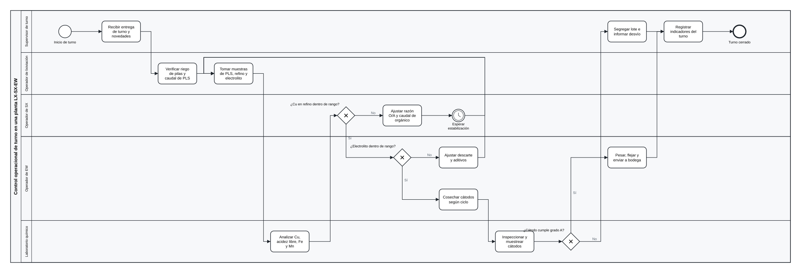
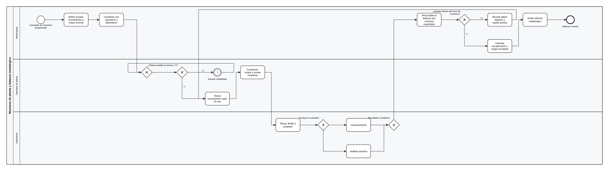
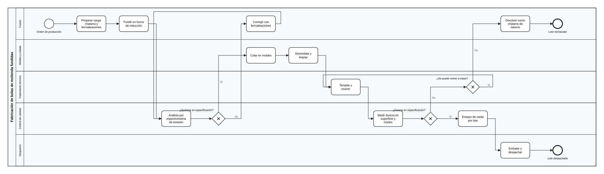

# procesos-bpmn

Procedimientos metalúrgicos modelados en **BPMN 2.0**, el estándar de la OMG que usan Bizagi Modeler, Camunda y bpmn.io.

Cada procedimiento se escribe en un YAML corto. Un generador en Python lo convierte en un archivo `.bpmn` que incluye:
- los roles en carriles;
- las compuertas de decisión;
- el diagrama dibujado (BPMNDI), para que el archivo se abra con el dibujo ya hecho.

**Son procedimientos genéricos e ilustrativos, armados desde la práctica habitual de la industria. No son los de ninguna empresa.** Los rangos de control, las especificaciones y los responsables los fija cada planta.

| Procedimiento | Archivo | Carriles | Nodos |
|---|---|---|---|
| Control operacional de turno en una planta LX-SX-EW | [`salidas/lx_sx_ew.bpmn`](salidas/lx_sx_ew.bpmn) | 5 | 17 |
| Muestreo de planta y balance metalúrgico | [`salidas/muestreo_balance.bpmn`](salidas/muestreo_balance.bpmn) | 3 | 18 |
| Fabricación de bolas de molienda fundidas | [`salidas/bolas_molienda.bpmn`](salidas/bolas_molienda.bpmn) | 5 | 17 |

### Control de turno LX-SX-EW


### Muestreo y balance metalúrgico
La reconciliación por mínimos cuadrados de este procedimiento es la que implementa [simulador-conminucion](https://github.com/Laxionx/simulador-conminucion).



### Bolas de molienda fundidas


Las imágenes son vistas previas con las mismas coordenadas que el BPMNDI del archivo. Bizagi dibuja con su propio estilo.

## Abrir en Bizagi Modeler

Bizagi Modeler importa archivos BPMN 2.0 (`.bpmn`). **Pendiente:** no se probó aquí, porque Bizagi no está instalado en la máquina donde se generaron. Lo que sí está comprobado es que cada archivo cumple el esquema oficial de la OMG (ver abajo).

## Uso

```bash
pip install -e ".[dev]"
python -m procesos_bpmn generar definiciones salidas
python -m procesos_bpmn validar salidas --xsd xsd
```

Para validar contra el esquema, se bajan los XSD oficiales de la OMG a `xsd/`. No se incluyen en el repositorio porque no traen una licencia explícita:

```bash
mkdir -p xsd
for f in BPMN20.xsd Semantic.xsd BPMNDI.xsd DC.xsd DI.xsd; do
  curl -sfL -o "xsd/$f" "https://www.omg.org/spec/BPMN/20100501/$f"
done
```

Un procedimiento nuevo es un YAML en `definiciones/`. Tipos de nodo disponibles:
- `inicio`, `fin`, `espera` (temporizador);
- `tarea`, `tarea_usuario`, `tarea_manual`, `tarea_servicio`;
- `decision` (compuerta exclusiva), `paralelo`.

```yaml
id: mi_procedimiento
nombre: Mi procedimiento
carriles: [Operador, Supervisor]
nodos:
  - {id: inicio, tipo: inicio, nombre: Inicio, carril: Operador}
  - {id: revisar, tipo: tarea_manual, nombre: Revisar equipo, carril: Operador}
  - {id: ok, tipo: decision, nombre: "¿Equipo en condiciones?", carril: Supervisor}
  - {id: fin, tipo: fin, nombre: Fin, carril: Supervisor}
flujos:
  - [inicio, revisar]
  - [revisar, ok]
  - [ok, fin, "Sí"]
  - [ok, revisar, "No"]
```

## Validación

Los criterios se fijaron antes de correr (`tests/test_bpmn.py`, 36 pruebas, cobertura del 96 %).

| Control | Qué comprueba |
|---|---|
| XSD oficial de la OMG | Los 3 archivos validan contra BPMN 2.0 (formal/2011-01-03). Un archivo roto a propósito (un flujo sin destino) es rechazado. |
| Reglas de modelado | Hay inicio y fin. Todo nodo es alcanzable desde el inicio y tiene camino a un fin. Las salidas de cada decisión tienen nombre. No hay flujos repetidos. |
| Dibujo | Las formas no se solapan y quedan dentro de su carril. Las flechas son ortogonales, salen y llegan al borde de sus formas, no atraviesan otras formas, y dos salidas del mismo origen no se superponen. |
| Consistencia del XML | Hay una forma por piscina, carril y nodo, y una arista por flujo. Los carriles reparten los nodos sin repetir. Incoming y outgoing cuadran. |
| Archivos publicados | Los `.bpmn` de `salidas/` coinciden byte a byte con lo que genera su YAML. |

Para comprobar que las pruebas pueden fallar, se metieron 6 errores a propósito y todos se detectaron:
- compuertas sin salida lateral;
- vueltas que entran por arriba;
- nodos sin `incoming`;
- carriles vacíos;
- nodos apilados en la misma fila;
- decisiones sin nombre.

**Hallazgo del propio proceso:** la primera versión del trazado cumplía todas las reglas, pero la vista previa mostró que una vuelta atravesaba una forma. De ahí salió la regla «no atraviesa otras formas». Esa regla detectó un segundo caso, en el muestreo, que se corrigió haciendo bajar las vueltas por el pasillo entre columnas.

## Límites

- El trazado es automático y simple. Las vueltas largas pueden cruzar otras líneas, aunque nunca formas, y en Bizagi se pueden reacomodar.
- Solo se usan los elementos de un proceso en una piscina. No se modelan mensajes entre piscinas, subprocesos ni datos.

## Estructura

```
procesos_bpmn/  modelo (YAML), diagrama (trazado), bpmn (XML), validar, vista (SVG)
definiciones/   un YAML por procedimiento
salidas/        los .bpmn para importar
docs/img/       vistas previas
tests/          pytest
```

Licencia MIT. Construido con desarrollo asistido por IA (Claude Code), con revisión y pruebas propias.
